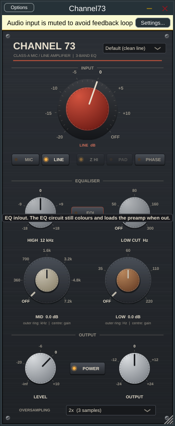

# Channel73

A VST3 channel-strip plug-in modelled on the classic 1073-style class-A mic/line amplifier and
3-band EQ, built from the control set and circuit behaviour described in the UAD Neve 1073
manual. It is designed for the lowest possible latency: **0 samples at 1x**, and 3 or 4 samples
(well under 0.1 ms at 48 kHz) in the oversampled modes.

Not affiliated with, endorsed by, or using any code or assets from AMS Neve or Universal Audio.
"Neve" and "1073" references in this README describe the hardware being emulated.



## Controls (mapped from the manual)

| Control | Behaviour in Channel73 |
|---|---|
| **MIC / LINE** | Selects the input. Mic and line gain are separate parameters, as in the manual. |
| **Red knob, mic** | OFF, -20 to -80 (sensitivity labels), 5 dB steps = +20 to +80 dB gain. Clockwise = more gain. OFF mutes. |
| **Red knob, line** | -20 to +10, 5 dB steps = +20 to -10 dB gain. Counter-clockwise = more gain (as the manual describes). OFF mutes. |
| **Z (impedance)** | LO = 300 Ω; HI = 1.2 kΩ at -20…-50, 600 Ω at -55…-80. Changes level (source loading) and the input transformer's HF damping. Mic only. |
| **PAD** | -20 dB, mic only. |
| **HIGH 12 kHz** | ±18 dB shelf. |
| **MID** (dual concentric) | Outer ring: OFF, 360, 700, 1.6k, 3.2k, 4.8k, 7.2k. Inner: ±18 dB. Q rises with frequency and with gain. |
| **LOW** (dual concentric) | Outer ring: OFF, 35, 60, 110, 220 Hz. Inner: ±15 dB. Slight bump/dip above the corner. |
| **LOW CUT** | OFF, 50, 80, 160, 300 Hz, 18 dB/octave. |
| **EQL** | EQ in/out (default out). With EQL out, the EQ circuit still colours the signal and its boost settings still change preamp clipping (EQ loading), as the manual notes. |
| **PHASE** | Polarity invert. |
| **LEVEL** | Output-stage fader, -∞ to +10 dB. Above 0 dB drives the output amplifier. |
| **OUTPUT** | Clean trim, ±24 dB, after the model (for driving the stages, then matching levels). |
| **POWER** | True bypass, delayed by the reported latency so nothing shifts in time. |
| **OVERSAMPLING** | 1x (0 samples), 2x (3 samples, default), 4x (4 samples). |

Clicking a printed value around a knob jumps to it; double-click a gain knob for 0 dB; clicking
the MID/LOW gain readout resets it. The window can be resized (fixed aspect).

Not reproduced: Unison (needs Apollo hardware), UA's artist presets (10 original presets are
included instead), and the separate Legacy plug-ins.

## Signal chain

```
input transformer  (impedance-dependent HF resonance, LF core saturation)
 → preamp stage 1  (class-A, asymmetric clip, dynamic bias drift)    [mic only]
 → preamp stage 2  (class-A; headroom reduced by EQ boost loading)
 → low cut → low shelf → mid bell → 12 kHz shelf                       [EQL in]
 → EQ amplifier    (always in path)
 → LEVEL fader → output amplifier (class-A) → output transformer
 → OUTPUT trim → polarity
```

Calibration: -18 dBFS = 0 dBu. "Line 0" is unity gain. The voicing constants (stage headroom,
2nd-harmonic amounts, bias drift) are in `Source/dsp/Channel73Dsp.h`, namespace `voicing`.

## How latency is kept at (or near) zero

* **No look-ahead, no FIR filters, per-sample processing.** Works at any buffer size, including 1.
* **Decramped EQ instead of oversampling.** The 12 kHz shelf and the 4.8/7.2 kHz bells would
  normally warp badly at 44.1/48 kHz. They are designed with magnitude-matched methods (after
  Vicanek), with cuts built as exact inverses of the matching boosts, so the EQ is within
  0.75 dB of the analog curve up to 20 kHz even at 1x (a plain bilinear design is 2.6 dB off by 16 kHz).
* **IIR half-band oversampling** (polyphase allpass, designed after de Soras' HIIR) for the
  nonlinear stages: ~100 dB image rejection with ~3 samples of delay, versus the dozens of
  samples a linear-phase FIR oversampler would add. That small delay is reported to the host
  (and applied to the dry/bypass path) so parallel tracks stay aligned.

Use **1x** when you need literally zero latency (clean or moderately driven, aliasing is
around -80 dBc). Use **2x** (default) or 4x when driving it hard.

## Measured (tests/dsp_tests.cpp, full output in docs/measurements.txt)

| | |
|---|---|
| Gain staging | Line 0 = 0.00 dB; Line -20 = +20.00; Mic -50 = +50.00; Pad = -20.00 |
| Low cut slope | 18.1 dB/oct |
| THD, line 0, 0 dBu out | 0.05 %, 2nd harmonic dominant (H2 -66 dBc, H3 -114 dBc) |
| THD, +20 dB drive | 2.7 %, even ≈ odd (asymmetric clipping) |
| Aliasing, heavy drive @ 7 kHz | 1x -29 dBc, 2x -89 dBc, 4x -93 dBc |
| Group delay @ 1 kHz, 48 kHz | 1x 0.005 ms, 2x 0.07 ms, 4x 0.09 ms |
| CPU, stereo 48 kHz | 1x ~1.7 %, 2x ~3.3 %, 4x ~6 % of one core |
| Stability | 2000 randomized parameter/block-size runs at 44.1–192 kHz, all finite |

The plug-in passes **pluginval at strictness level 10** (which includes Steinberg's VST3
validator) on Linux.

These figures describe the model, not a comparison against real hardware or UA's plug-in:
the voicing was built from the manual's description and general knowledge of the circuit,
and was not null-tested against a reference unit.

## Building

Requirements: CMake 3.22+, a C++17 compiler (Visual Studio 2022, Xcode, or GCC/Clang). JUCE
8.0.10 is downloaded automatically at configure time (or place a checkout in `third_party/JUCE`).

```bash
cmake -B build -DCMAKE_BUILD_TYPE=Release
cmake --build build --config Release --target Channel73_VST3
```

The plug-in lands in `build/Channel73_artefacts/Release/VST3/Channel73.vst3`. Copy it to:

* Windows: `C:\Program Files\Common Files\VST3\`
* macOS: `~/Library/Audio/Plug-Ins/VST3/` (for an unsigned local build, run `xattr -cr Channel73.vst3` if macOS blocks it)
* Linux: `~/.vst3/`

Linux needs: `libasound2-dev libx11-dev libxrandr-dev libxinerama-dev libxcursor-dev libxcomposite-dev libxext-dev libfreetype-dev libfontconfig1-dev libgl1-mesa-dev`.

A standalone app target (`Channel73_Standalone`) is also available.

**Without a local toolchain:** push this folder to a GitHub repository. The included workflow
(`.github/workflows/build.yml`) builds Windows, macOS (universal) and Linux VST3s, runs the DSP
test suite, and attaches the plug-ins as downloadable artifacts on each run.

**Tests:** `cmake --build build --target c73_dsp_tests && ./build/c73_dsp_tests` (no JUCE needed).

## Licensing

Your own code here is yours to license. JUCE is dual-licensed (AGPLv3 or a JUCE commercial
licence, which has a free tier under a revenue threshold); check its current terms before
distributing binaries.

## Layout

```
Source/dsp/Filters.h        analog prototypes, matched/hybrid/bilinear biquad design
Source/dsp/Oversampler.h    zero-FIR polyphase IIR half-band up/down sampler
Source/dsp/Channel73Dsp.h   the channel model (framework-independent)
Source/PluginProcessor.*    JUCE wrapper: parameters, presets, state, latency reporting
Source/PluginEditor.*       vector-drawn, resizable UI
tests/dsp_tests.cpp         measurement and regression suite
```
