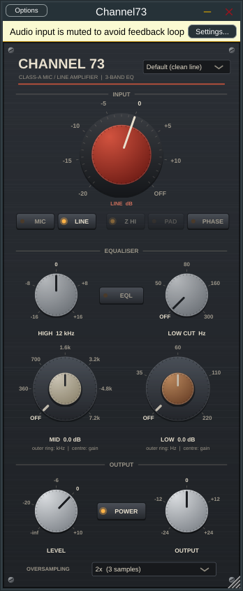
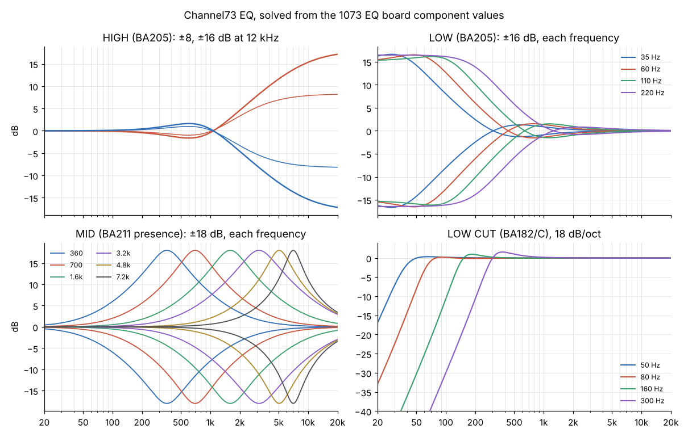

# Channel73

A VST3 channel-strip plug-in modelled on the classic 1073-style class-A mic/line amplifier and
3-band EQ. The controls follow the UAD Neve 1073 manual; levels, distortion, frequency
response and EQ ranges are calibrated to the published hardware datasheet (AMS Neve 1073/1084
User Manual, issue 5.1), and the gain staging and stage order follow Neve drawings E/10006
(level diagram) and EH10023 (1073 circuit). The EQ is solved directly from the component
values on the EQ board drawings (BA205, BA211, BA182). Automated tests check every datasheet
figure, the schematic-derived structure and the EQ against the circuit. It is designed for the lowest possible latency: **0 samples at 1x**, and 3 or 4 samples
(well under 0.1 ms at 48 kHz) in the oversampled modes.

Not affiliated with, endorsed by, or using any code or assets from AMS Neve or Universal Audio.
"Neve" and "1073" references in this README describe the hardware being emulated.



## Controls (mapped from the manual)

| Control | Behaviour in Channel73 |
|---|---|
| **MIC / LINE** | Selects the input. Mic and line gain are separate parameters, as in the manual. |
| **Red knob, mic** | OFF, -20 to -80 (sensitivity labels), 5 dB steps = +20 to +80 dB gain. Clockwise = more gain. OFF mutes. |
| **Red knob, line** | -20 to +10, 5 dB steps = +20 to -10 dB gain. Counter-clockwise = more gain (as the manual describes). OFF mutes. |
| **Z (impedance)** | LO = 300 Ω; HI = 1.2 kΩ at -20…-50, 600 Ω at -55…-80. On the 10468 transformer LO parallels the primaries for 6 dB more step-up, so with a 150 Ω mic LO is about 3.5–4.4 dB louder than HI (and slightly darker from the heavier load). Mic only. |
| **PAD** | -20 dB ahead of the mic transformer, mic only (not on the original module; UA's addition). |
| **HIGH 12 kHz** | ±16 dB, read as the gain at 12 kHz (datasheet range; UA's manual says ±18). Solved from the BA205 board. |
| **MID** (dual concentric) | Outer ring: OFF, 360, 700, 1.6k, 3.2k, 4.8k, 7.2k. Inner: ±18 dB at the centre frequency. Solved from the BA211 board, so the Q comes from the inductors and resistors: broad at the low positions, tighter towards 7.2 kHz, and it changes with gain. |
| **LOW** (dual concentric) | Outer ring: OFF, 35, 60, 110, 220 Hz. Inner: ±16 dB, read at half the selected frequency. Solved from the BA205 board, including the overshoot and the dip just above the shelf. |
| **LOW CUT** | OFF, 50, 80, 160, 300 Hz, 18 dB/octave. Solved from the BA182/C board (C-L-C with the tapped 10 H inductor, fed through R37 1K2, terminated by 5K1). |
| **EQL** | EQ in/out (default out). With EQL out, the EQ circuit still colours the signal and its boost settings still change preamp clipping (EQ loading), as the manual notes. |
| **PHASE** | Polarity invert. |
| **LEVEL** | Output-stage fader, -∞ to +10 dB, as on UA's console-fader version. Above 0 dB drives the output amplifier. (The rack unit's output pot only attenuates, unity fully clockwise; just keep LEVEL at or below 0 for that behaviour.) |
| **OUTPUT** | Clean trim, ±24 dB, after the model (for driving the stages, then matching levels). |
| **POWER** | True bypass, delayed by the reported latency so nothing shifts in time. |
| **OVERSAMPLING** | 1x (0 samples), 2x (3 samples, default), 4x (4 samples). |

Clicking a printed value around a knob jumps to it; double-click a gain knob for 0 dB; clicking
the MID/LOW gain readout resets it. The window can be resized (fixed aspect).

Not reproduced: Unison (needs Apollo hardware), UA's artist presets (10 original presets are
included instead), and the separate Legacy plug-ins.

## Signal chain

Stage order and node levels from Neve drawings E/10006 and EH10023 (levels for 0 dBu out):

```
MIC:   10468 transformer (1200 R or 300 R into 4k8)
        → first amp, BA184/BA284 (only on -55…-80)            -42 dBu
        → BA283AM, +28 dB                                      -14 dBu
       (-20…-50 skip the first amp via an attenuator)
LINE:  31267 transformer (10k:600, -12 dB) → attenuator
        → BA283AM, +18 dB                                      -14 dBu
EQ (EQL in), each board solved from its component values:
        BA205 LF + 12 kHz shelves → EQ amp A
        → BA211 presence (mid) → EQ amp B
        → BA182 passive high-pass (last)
       (with EQL out the EQ input still hangs on the BA283AM and loads it)
→ LEVEL → BA283AV output amp → LO1166 transformer                0 dBu
→ OUTPUT trim → polarity
```

Every gain stage is a class-A model (asymmetric clipping, 2nd-harmonic term, bias drift
with signal); each transformer has flux-driven core saturation and an HF resonance. Because
the first amp idles at -42 dBu and the EQ section at -14 dBu, the output stage is the first to
clip with EQ out, whichever input route is used. Big EQ boosts can clip the EQ amps first.

Calibration: -18 dBFS = 0 dBu (the hardware's nominal line in/out level). "Line 0" is unity
gain. The voicing constants (stage headroom, 2nd-harmonic amounts, bias drift, transformer
saturation) are in `Source/dsp/Channel73Dsp.h`, namespace `voicing`.

## Datasheet conformance

Measured by `tests/dsp_tests.cpp` section [9] at 192 kHz (so 40 kHz and the 80 kHz THD
bandwidth are inside the band):

| Hardware spec (issue 5.1, p.9) | Channel73 |
|---|---|
| Mic gain +20 to +80 dB, 5 dB steps; line +20 to -10 dB | exact on all 13 mic and 7 line positions |
| Mic input impedance 300 Ω / 1200 Ω | Mic Z LO / HI (HI is 600 Ω at -55…-80, per UA) |
| Response ±0.5 dB 20 Hz–20 kHz, EQ out | 20 Hz -0.22 dB, 20 kHz -0.11 to -0.40 dB depending on input/Mic Z |
| -3 dB at 40 kHz | -2.9 to -3.6 dB depending on Mic Z |
| THD ≤ 0.07 %, 50 Hz–10 kHz, +20 dBu out, 80 kHz BW | 0.023 % (100 Hz–10 kHz), 0.046 % (50 Hz); same through +20 dB of line gain or +60 dB of mic gain |
| Max output > +26 dBu | +27.2 dBu (at 1 % THD, 1 kHz) |
| HF ±16 dB shelf @ 12 kHz; LF ±16 dB shelf; mid ±18 dB | ±16.0 / ±16.0 / ±18.0 dB |
| HPF 18 dB/octave, 50/80/160/300 Hz | 16–18.5 dB/oct in the octave below the corner (see below) |

What this means for the sound: like the real unit, Channel73 is very clean at normal levels
(0.003 % at 0 dBu, almost all 2nd harmonic). Below 50 Hz the transformers start to saturate
(0.26 % at 20 Hz, +20 dBu). The famous grit only appears when you push the output past about
+24 dBu, i.e. turn up the input gain (or LEVEL) and bring the OUTPUT trim down. With the
-18 dBFS = 0 dBu calibration, a signal peaking at -6 dBFS with LINE at -20 (+20 dB) is in
that zone.

Not modelled: the hardware's noise floor (-83 dBu output noise, EIN -125 dBu).

## How latency is kept at (or near) zero

* **No look-ahead, no FIR filters, per-sample processing.** Works at any buffer size, including 1.
* **Decramped EQ instead of oversampling.** Each EQ board's analog transfer function is
  factored into poles and zeros and turned into first/second-order digital sections. For
  each section several designs are tried (bilinear warped at the pole or zero, warped poles
  with a magnitude-fitted numerator after Vicanek, matched), and the one that keeps the whole
  cascade closest to the circuit wins. Result at 1x: within 0.96 dB of the circuit at 44.1 kHz
  and 0.83 dB at 48 kHz from 20 Hz to 20 kHz on every setting (the worst cases are only in
  the top octave at extreme boosts), and within 0.3 dB at 96 kHz.
* **IIR half-band oversampling** (polyphase allpass, designed after de Soras' HIIR) for the
  nonlinear stages: ~100 dB image rejection with ~3 samples of delay, versus the dozens of
  samples a linear-phase FIR oversampler would add. That small delay is reported to the host
  (and applied to the dry/bypass path) so parallel tracks stay aligned.

Use **1x** when you need literally zero latency (at normal levels aliasing is below
-120 dBc). Use **2x** (default) or 4x when driving it into clipping.

## Measured (tests/dsp_tests.cpp, full output in docs/measurements.txt)

| | |
|---|---|
| Gain staging | Line 0 = 0.00 dB; Line -20 = +20.00; Mic -50 = +50.00; Pad = -20.00 |
| THD, line 0, 0 dBu out | 0.003 %, 2nd harmonic dominant (H2 -89 dBc, H3 -154 dBc) |
| THD, driven past +26 dBu | 1.5 % at Line -20 with -10 dBFS in, even ≈ odd (asymmetric clipping) |
| Aliasing, heavy drive @ 7 kHz | 1x -44 dBc, 2x -116 dBc, 4x -120 dBc |
| Group delay @ 1 kHz, 48 kHz | 1x 0.003 ms, 2x 0.07 ms, 4x 0.09 ms |
| CPU, stereo 48 kHz | 1x ~1.8 %, 2x ~3.6 %, 4x ~7 % of one core; ~8 % at 2x with all three EQ knobs moving continuously |
| Stability | 2000 randomized parameter/block-size runs at 44.1–192 kHz, all finite |

The plug-in passes **pluginval at strictness level 10** (which includes Steinberg's VST3
validator) on Linux.

## The EQ, from the board drawings



`Source/dsp/CircuitEq.h` holds each board as a circuit and solves it by nodal analysis every
time a knob or switch changes, with the EQ amps as ideal inverting virtual-earth stages:

* **BA205 (D/10042), HF + LF.** HF: 620 Ω + 22 nF to each end of RV1 (10K), wiper through
  15 nF to the amp's virtual earth. That 620 Ω / 22 nF corner is 11.7 kHz, the "12 kHz"
  shelf. LF: 6K2 to each end of RV2 (50K), wiper through 12K to the virtual earth, S3 switching
  15/47/100/200 nF from each pot end to a common node that goes to the wiper through 10 nF
  and to 0 V through 12K. Both share EQ amp A, so they are solved together and interact.
* **BA211 (D/10048), presence.** A 10K pot bridging the amp's input and output, its wiper
  feeding a series L-C to the virtual earth through 2K7, with 6K8/6K8/8K2 setting the flat gain.
  T1530 is tapped for 360/700/1.6k with 100/47/22 nF; T1280 (~0.21 H) serves 3.2k/4.8k/7.2k
  with 12.2/4.7/2.42 nF. This has a closed-form solution, and its maximum works out at
  ±18.6–19.3 dB, in line with the ±18 dB spec.
* **BA182/C (D/10019C), low cut.** Series C, shunt tapped inductor (10/7/3/1.3 H taps),
  series C, driven through R37 (1K2) and terminated by 5K1.

What the drawings don't give, and is estimated: inductor winding resistances (T1530 ~300 Ω
at full winding, T1280 40 Ω, T1295 60 Ω per henry), the T1530 tap inductances (solved from
the panel frequencies), pot tapers (the knobs are calibrated in dB instead), and EQ amp
compensation (the 180 pF / 470 pF caps on BA284 are not modelled). Consequences worth knowing:
the 4.8 kHz presence position lands near 5.1 kHz with the drawn 4.7 nF and a single
~0.21 H inductor; the high-pass -3 dB points come out at about 37/61/130/262 Hz, below the
marked frequencies, with +0.3/+0.2/+1.0/+1.6 dB of lift above the corner; and boosting HF
gives a ~1.5 dB opposite-going bump around 500 Hz from the LF network's 10 nF/12K branch.
These are what the circuit predicts, not measurements of a unit.

The datasheet and drawings fix the levels, limits, topology and EQ components, not a full
fingerprint: harmonic balance, clipping shape beyond +26 dBu and transformer behaviour below
50 Hz are still modelled, and nothing was null-tested against a reference unit.

## Building

Requirements: CMake 3.22+, a C++17 compiler (Visual Studio 2022, Xcode, or GCC/Clang). JUCE
8.0.10 is downloaded automatically at configure time (or place a checkout in `third_party/JUCE`).

```bash
cmake -B build -DCMAKE_BUILD_TYPE=Release
cmake --build build --config Release --target Channel73_VST3
```

The plug-in lands in `build/Channel73_artefacts/Release/VST3/Channel73.vst3`. Copy it to:

* Windows: `C:\Program Files\Common Files\VST3\`
* macOS: `~/Library/Audio/Plug-Ins/VST3/` (for an unsigned local build, run `xattr -cr Channel73.vst3` if macOS blocks it)
* Linux: `~/.vst3/`

Linux needs: `libasound2-dev libx11-dev libxrandr-dev libxinerama-dev libxcursor-dev libxcomposite-dev libxext-dev libfreetype-dev libfontconfig1-dev libgl1-mesa-dev`.

A standalone app target (`Channel73_Standalone`) is also available.

**Without a local toolchain:** push this folder to a GitHub repository. The included workflow
(`.github/workflows/build.yml`) builds Windows, macOS (universal) and Linux VST3s, runs the DSP
test suite, and attaches the plug-ins as downloadable artifacts on each run.

**Tests:** `cmake --build build --target c73_dsp_tests && ./build/c73_dsp_tests` (no JUCE needed).

## Licensing

Your own code here is yours to license. JUCE is dual-licensed (AGPLv3 or a JUCE commercial
licence, which has a free tier under a revenue threshold); check its current terms before
distributing binaries.

## Layout

```
Source/dsp/Filters.h        analog prototypes, matched/hybrid/bilinear biquad design
Source/dsp/CircuitEq.h      BA205/BA211/BA182 EQ boards: nodal analysis, poles/zeros, digitisation
Source/dsp/Oversampler.h    zero-FIR polyphase IIR half-band up/down sampler
Source/dsp/Channel73Dsp.h   the channel model (framework-independent)
Source/PluginProcessor.*    JUCE wrapper: parameters, presets, state, latency reporting
Source/PluginEditor.*       vector-drawn, resizable UI
tests/dsp_tests.cpp         measurement and regression suite
```
